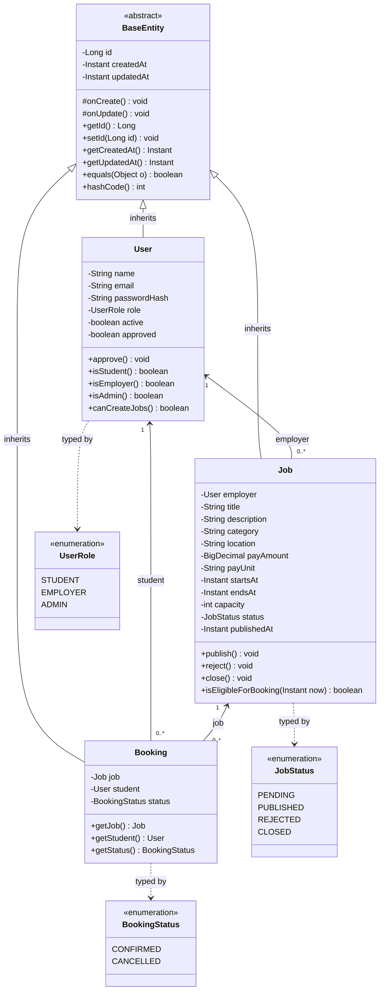
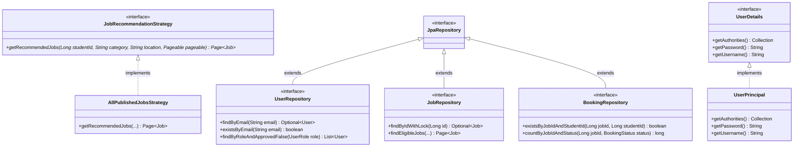

# UniShift / NextShift — Comprehensive OOP Concepts & Architecture Analysis
# වස්තු-පාදක ක්‍රමලේඛන (OOP) මූලධර්ම සහ පද්ධති නිර්මාණ ශිල්පීය පුළුල් විග්‍රහය

> **Project**: UniShift (NextShift) Backend  
> **Tech Stack**: Java 21, Spring Boot 3.3.5, Spring Data JPA, Spring Security, Flyway, JJWT  
> **Target Audience**: Software Engineers, Technical Evaluators, University Viva Panelists  
> **Scope**: In-depth analysis of Classes, Subclasses, Interfaces, Polymorphism, Encapsulation, Abstraction, and Inheritance directly mapped to the codebase.

---

## Table of Contents / පටුන
1. [Executive Summary / විධායක සාරාංශය](#1-executive-summary--විධායක-සාරාංශය)
2. [Domain Class Hierarchy Diagram / පන්ති සබඳතා රූපසටහන](#2-domain-class-hierarchy-diagram--පන්ති-සබඳතා-රූපසටහන)
3. [Classes (පන්ති)](#3-classes-පන්ති)
4. [Subclasses & Class Hierarchies (අනුපන්ති සහ උරුම ගස්)](#4-subclasses--class-hierarchies-අනුපන්ති-සහ-උරුම-ගස්)
5. [Interfaces (අතුරුමුහුණත්)](#5-interfaces-අතුරුමුහුණත්)
6. [Polymorphism (බහුරූපතාවය)](#6-polymorphism-බහුරූපතාවය)
7. [Encapsulation (කැප්සියුලීකරණය)](#7-encapsulation-කැප්සියුලීකරණය)
8. [Abstraction (වියුක්තකරණය)](#8-abstraction-වියුක්තකරණය)
9. [Inheritance (උරුමය)](#9-inheritance-උරුමය)
10. [Design Patterns & SOLID Principles Alignment](#10-design-patterns--solid-principles-alignment)
11. [Viva / Oral Examination Preparation Cheatsheet](#11-viva--oral-examination-preparation-cheatsheet)

---

## 1. Executive Summary / විධායක සාරාංශය

UniShift (NextShift) backend is engineered with an enterprise-grade, clean Object-Oriented architecture adhering to Domain-Driven Design (DDD) and SOLID principles. The system cleanly separates responsibilities across **Entities**, **Controllers**, **Services**, **Repositories**, **Security Tokens**, and **DTO Records**, while rigorously utilizing the four fundamental pillars of Object-Oriented Programming (OOP):

| OOP Pillar (මූලධර්මය) | Concrete Implementation in UniShift | Primary Code Locations |
|---|---|---|
| **Classes & Subclasses** | Rich Domain Models, Abstract Base Superclass, Specialized Exceptions, Web Filters | `User`, `Job`, `Booking`, `BaseEntity`, `ApiException`, `JwtAuthenticationFilter` |
| **Interfaces** | Extensible Strategy Contracts, Spring Data Repositories, Spring Security Contracts | `JobRecommendationStrategy`, `UserRepository`, `JobRepository`, `UserDetails` |
| **Polymorphism** | Strategy Pattern (Runtime algorithm injection), Security Principal polymorphism, Method Overriding & Overloading | `JobRecommendationStrategy` $\rightarrow$ `AllPublishedJobsStrategy`, `UserPrincipal` as `UserDetails` |
| **Encapsulation** | Strict data hiding (`private` fields), Controlled state mutation methods, Immutable Java 21 `record` DTOs, Exception shielding | `Job.publish()`, `Job.isEligibleForBooking()`, `RegisterRequest`, `ApiExceptionHandler` |
| **Abstraction** | Abstract Base Classes, Decoupled recommendation contracts, Repository data access abstraction | `BaseEntity`, `JobRecommendationStrategy`, `BookingRepository` |
| **Inheritance** | MappedSuperclass lifecycle inheritance, Multi-level API exception hierarchy | `BaseEntity` $\rightarrow$ Entities; `RuntimeException` $\rightarrow$ `ApiException` $\rightarrow$ Specific exceptions |

---

## 2. Domain Class Hierarchy Diagram / පන්ති සබඳතා රූපසටහන



---

## 3. Classes (පන්ති)

A **Class** in Object-Oriented Programming serves as a blueprint or template from which individual objects are instantiated. It defines the state (attributes/fields) and behavior (methods) that objects of that type will possess.

In UniShift, classes are organized into distinct layers, each adhering to the **Single Responsibility Principle (SRP)**:

### 3.1 Classification of Classes in UniShift

| Category | Classes | Purpose & Description |
|---|---|---|
| **Domain Entities** | `User`, `Job`, `Booking` | Core persistent business objects mapped to database tables using JPA (`@Entity`). |
| **Abstract Classes** | `BaseEntity`, `ApiException` | Template classes that cannot be directly instantiated; provide shared state and behavior. |
| **REST Controllers** | `AuthController`, `JobController`, `BookingController`, `EmployerController`, `AdminController`, `HealthController` | Presentation layer classes annotated with `@RestController` that handle incoming HTTP requests and format responses. |
| **Application Services** | `AuthService`, `JobService`, `BookingService`, `AdminService` | Business logic layer annotated with `@Service`. Manages transactional boundaries (`@Transactional`) and coordinates domain operations. |
| **Data Transfer Objects (DTOs)** | `RegisterRequest`, `LoginRequest`, `AuthResponse`, `UserResponse`, `CreateJobRequest`, `JobResponse`, `BookingResponse`, `ErrorResponse` | Java 21 `record` classes used to pass structured, immutable data across HTTP boundaries without exposing internal database entities. |
| **Security & Authentication** | `JwtService`, `JwtAuthenticationFilter`, `UserPrincipal`, `CustomUserDetailsService`, `SecurityConfig`, `AdminBootstrapConfig` | Handle token creation, request filtering, password hashing, and role-based authorization. |
| **Exception Handlers & Hierarchy** | `ApiExceptionHandler`, `ApiException`, `BadRequestException`, `ConflictException`, `ForbiddenException`, `ResourceNotFoundException`, `UnauthorizedException` | Capture and translate application faults into structured REST error responses. |
| **Enumerations** | `UserRole`, `JobStatus`, `BookingStatus` | Type-safe state and permission definitions (`STUDENT`, `EMPLOYER`, `ADMIN`, etc.). |

### 3.2 Concrete Class Example: Rich Domain Model (`Job.java`)
In `src/main/java/com/unishift/unishift_backend/job/Job.java`:
```java
@Entity
@Table(name = "jobs")
public class Job extends BaseEntity {

    @ManyToOne(fetch = FetchType.LAZY, optional = false)
    @JoinColumn(name = "employer_id", nullable = false)
    private User employer;

    @Column(nullable = false)
    private String title;

    @Column(nullable = false, columnDefinition = "TEXT")
    private String description;

    @Column(nullable = false)
    private String category;

    @Column(nullable = false)
    private String location;

    @Column(name = "pay_amount", nullable = false, precision = 10, scale = 2)
    private BigDecimal payAmount;

    @Column(name = "pay_unit", nullable = false)
    private String payUnit;

    @Column(name = "starts_at", nullable = false)
    private Instant startsAt;

    @Column(name = "ends_at", nullable = false)
    private Instant endsAt;

    @Column(nullable = false)
    private int capacity;

    @Enumerated(EnumType.STRING)
    @Column(nullable = false)
    private JobStatus status = JobStatus.PENDING;

    @Column(name = "published_at")
    private Instant publishedAt;

    // Constructors, domain methods, getters, and setters...
}
```

---

## 4. Subclasses & Class Hierarchies (අනුපන්ති සහ උරුම ගස්)

A **Subclass** (also called a derived or child class) is a class that inherits attributes and methods from an existing class (the superclass or parent class) using the `extends` keyword in Java. Subclasses can add new fields and methods, or override superclass methods to provide specialized behavior.

UniShift features three distinct subclass hierarchies:

### 4.1 Hierarchy 1: Domain Entity Subclasses (`BaseEntity` Tree)
The abstract superclass `BaseEntity` is extended by all persistent domain entities:

```
          BaseEntity (Abstract Superclass)
          ├── User (Subclass)
          ├── Job (Subclass)
          └── Booking (Subclass)
```

- **Inherited State**: `id`, `createdAt`, `updatedAt`
- **Inherited Behavior**: `@PrePersist onCreate()`, `@PreUpdate onUpdate()`, identity-safe `equals()` and `hashCode()`
- **Subclass Specialization**:
  - `User` adds email, password hash, role, approval state, and methods `approve()`, `canCreateJobs()`.
  - `Job` adds employer relationship, title, capacity, pay amount, and methods `publish()`, `isEligibleForBooking()`.
  - `Booking` adds relationships to `Job` and `User` (student), plus booking status (`CONFIRMED`, `CANCELLED`).

```java
// User Subclass
public class User extends BaseEntity { ... }

// Job Subclass
public class Job extends BaseEntity { ... }

// Booking Subclass
public class Booking extends BaseEntity { ... }
```

### 4.2 Hierarchy 2: Exception Subclasses (`ApiException` Tree)
A structured exception hierarchy ensures clean error propagation and consistent HTTP status code mapping:

```
               java.lang.RuntimeException
                          │
                     ApiException (Superclass)
                          │
       ┌──────────────────┼──────────────────┬─────────────────┬──────────────────┐
       ▼                  ▼                  ▼                 ▼                  ▼
BadRequestException  ConflictException  ForbiddenException  ResourceNotFoundException  UnauthorizedException
    (HTTP 400)          (HTTP 409)          (HTTP 403)            (HTTP 404)             (HTTP 401)
```

```java
// Superclass: Defines status code property
public class ApiException extends RuntimeException {
    private final HttpStatus status;

    public ApiException(String message, HttpStatus status) {
        super(message);
        this.status = status;
    }

    public HttpStatus getStatus() {
        return status;
    }
}

// Subclass 1: Specializes for HTTP 409 Conflict (e.g., duplicate email, booking capacity full)
public class ConflictException extends ApiException {
    public ConflictException(String message) {
        super(message, HttpStatus.CONFLICT);
    }
}

// Subclass 2: Specializes for HTTP 404 Not Found (e.g., job or user does not exist)
public class ResourceNotFoundException extends ApiException {
    public ResourceNotFoundException(String message) {
        super(message, HttpStatus.NOT_FOUND);
    }
}

// Subclass 3: Specializes for HTTP 400 Bad Request (e.g., invalid date ranges)
public class BadRequestException extends ApiException {
    public BadRequestException(String message) {
        super(message, HttpStatus.BAD_REQUEST);
    }
}

// Subclass 4: Specializes for HTTP 403 Forbidden (e.g., unapproved employer creating jobs)
public class ForbiddenException extends ApiException {
    public ForbiddenException(String message) {
        super(message, HttpStatus.FORBIDDEN);
    }
}

// Subclass 5: Specializes for HTTP 401 Unauthorized (e.g., bad credentials, missing JWT)
public class UnauthorizedException extends ApiException {
    public UnauthorizedException(String message) {
        super(message, HttpStatus.UNAUTHORIZED);
    }
}
```

### 4.3 Hierarchy 3: Spring Framework Subclasses
- `JwtAuthenticationFilter extends OncePerRequestFilter`: Subclasses Spring Security’s base HTTP filter to intercept every request, extract the Bearer token, validate it, and establish the `SecurityContext`.

---

## 5. Interfaces (අතුරුමුහුණත්)

An **Interface** in Java is an abstract contract that defines *what* behaviors a class must perform without prescribing *how* those behaviors are executed. It establishes loose coupling between software components.

UniShift leverages interfaces across three architectural tiers:



### 5.1 Business Strategy Interface (`JobRecommendationStrategy`)
Located at `src/main/java/com/unishift/unishift_backend/recommendation/JobRecommendationStrategy.java`:
```java
package com.unishift.unishift_backend.recommendation;

import com.unishift.unishift_backend.job.Job;
import org.springframework.data.domain.Page;
import org.springframework.data.domain.Pageable;

public interface JobRecommendationStrategy {

    Page<Job> getRecommendedJobs(Long studentId, String category, String location, Pageable pageable);
}
```
**Why this interface exists**:
- It decouples `JobService` from database queries and ranking logic.
- It enables dynamic polymorphism: new recommendation engines (e.g., collaborative filtering, geolocation proximity) can be plugged in without modifying `JobService`.

### 5.2 Persistence Interfaces (`Spring Data JPA Repositories`)
UniShift repositories define query contracts extending Spring Data's `JpaRepository<T, ID>`:
```java
public interface UserRepository extends JpaRepository<User, Long> {
    Optional<User> findByEmail(String email);
    boolean existsByEmail(String email);
    List<User> findByRoleAndApprovedFalse(UserRole role);
}

public interface JobRepository extends JpaRepository<Job, Long> {
    @Lock(LockModeType.PESSIMISTIC_WRITE)
    @Query("SELECT j FROM Job j WHERE j.id = :id")
    Optional<Job> findByIdWithLock(@Param("id") Long id);

    @Query("""
        SELECT j FROM Job j
        JOIN j.employer e
        WHERE j.status = :status
          AND e.active = true
          AND e.approved = true
          AND j.startsAt > :now
          AND (:category IS NULL OR LOWER(j.category) = LOWER(:category))
          AND (:location IS NULL OR LOWER(j.location) = LOWER(:location))
          AND j.capacity > (
              SELECT COUNT(b) FROM Booking b
              WHERE b.job = j AND b.status = :confirmedStatus
          )
        ORDER BY j.publishedAt DESC, j.id DESC
    """)
    Page<Job> findEligibleJobs(...);
}

public interface BookingRepository extends JpaRepository<Booking, Long> {
    boolean existsByJobIdAndStudentId(Long jobId, Long studentId);
    long countByJobIdAndStatus(Long jobId, BookingStatus status);
    List<Booking> findByStudentIdOrderByCreatedAtDesc(Long studentId);
}
```

### 5.3 Security Interfaces
- `UserDetails`: Contract implemented by `UserPrincipal` representing the authenticated user in Spring Security.
- `UserDetailsService`: Contract implemented by `CustomUserDetailsService` with the single method `loadUserByUsername(String email)`.

---

## 6. Polymorphism (බහුරූපතාවය)

**Polymorphism** (Greek for "many forms") is the ability of an object, reference, or method to behave differently depending on the runtime context.

### 6.1 Subtype Polymorphism (Strategy Pattern)
The most prominent example of polymorphism in UniShift is the **Strategy Pattern** used in the job recommendation engine:

1. **Client depends on Abstraction**: `JobService` references the `JobRecommendationStrategy` interface, **not** the concrete class `AllPublishedJobsStrategy`.
2. **Runtime Binding**: Spring’s Dependency Injection container automatically injects the `@Primary` bean `AllPublishedJobsStrategy` into `JobService`.
3. **Polymorphic Invocation**:
```java
@Service
public class JobService {

    // Polymorphic reference: holds any implementation of JobRecommendationStrategy
    private final JobRecommendationStrategy recommendationStrategy;

    public JobService(
        JobRepository jobRepository,
        UserRepository userRepository,
        BookingRepository bookingRepository,
        JobRecommendationStrategy recommendationStrategy // Injected polymorphically
    ) {
        this.jobRepository = jobRepository;
        this.userRepository = userRepository;
        this.bookingRepository = bookingRepository;
        this.recommendationStrategy = recommendationStrategy;
    }

    @Transactional(readOnly = true)
    public Page<JobResponse> getPublishedJobs(String studentEmail, String category, String location, Pageable pageable) {
        Long studentId = ...;

        // Polymorphic call: executes the active strategy's implementation at runtime
        Page<Job> jobPage = recommendationStrategy.getRecommendedJobs(studentId, category, location, pageable);

        return jobPage.map(job -> ...);
    }
}
```

```
       ┌────────────────────────────┐
       │         JobService         │
       └──────────────┬─────────────┘
                      │ calls getRecommendedJobs()
                      ▼
       ┌────────────────────────────┐
       │ <<interface>>              │
       │ JobRecommendationStrategy  │
       └──────────────▲─────────────┘
                      │ implements
       ┌──────────────┴─────────────┐
       │  AllPublishedJobsStrategy  │ (Can be swapped with MLRecommendationStrategy
       └────────────────────────────┘  without modifying JobService)
```

### 6.2 Framework Polymorphism (Spring Security `UserDetails`)
- The security filter chain expects instances conforming to `UserDetails`.
- `UserPrincipal` implements `UserDetails`.
- Spring Security treats `UserPrincipal` polymorphically inside authentication tokens and method security checks.

### 6.3 Method Overriding (`@Override` — Dynamic / Runtime Polymorphism)
Method overriding occurs when a subclass or implementation class provides its own specific implementation of a method defined in its superclass or interface:

1. **`AllPublishedJobsStrategy` overrides `JobRecommendationStrategy`**:
   ```java
   @Override
   public Page<Job> getRecommendedJobs(Long studentId, String category, String location, Pageable pageable) {
       return jobRepository.findEligibleJobs(...);
   }
   ```
2. **`BaseEntity` overrides `java.lang.Object` methods**:
   `equals(Object o)` and `hashCode()` are overridden to evaluate entity equality strictly based on database identity (`id`), preventing issues with Hibernate proxies:
   ```java
   @Override
   public boolean equals(Object o) {
       if (this == o) return true;
       if (o == null || getClass() != o.getClass()) return false;
       BaseEntity that = (BaseEntity) o;
       return id != null && Objects.equals(id, that.id);
   }

   @Override
   public int hashCode() {
       return getClass().hashCode();
   }
   ```
3. **`UserPrincipal` overrides `UserDetails` methods**:
   ```java
   @Override
   public Collection<? extends GrantedAuthority> getAuthorities() { return authorities; }

   @Override
   public String getPassword() { return password; }

   @Override
   public String getUsername() { return email; }

   @Override
   public boolean isEnabled() { return active; }
   ```

### 6.4 Method Overloading (Compile-Time / Static Polymorphism)
Method overloading occurs when multiple methods in the same class share the same name but have different parameter signatures:

In `JwtService.java`:
```java
// Overload 1: Generates token with default claims
public String generateToken(UserDetails userDetails) {
    return generateToken(userDetails, Collections.emptyMap());
}

// Overload 2: Generates token with custom extra claims (userId, role, approved)
public String generateToken(UserDetails userDetails, Map<String, Object> extraClaims) {
    // JWT creation logic...
}
```

In `User.java`:
- `public User()` (default no-arg constructor required by JPA)
- `public User(String name, String email, String passwordHash, UserRole role, boolean active, boolean approved)` (parameterized constructor for initialization)

---

## 7. Encapsulation (කැප්සියුලීකරණය)

**Encapsulation** is the bundling of data (attributes) and the methods that operate on that data into a single unit (class), while hiding internal state and restricting unauthorized or uncontrolled access from outside the class.

### 7.1 Data Hiding via Access Modifiers
Every entity in UniShift marks its attributes strictly as `private`. External classes cannot directly access or corrupt internal state:
```java
public class User extends BaseEntity {
    @Column(nullable = false)
    private String name;

    @Column(nullable = false, unique = true)
    private String email;

    @Column(name = "password_hash", nullable = false)
    private String passwordHash;

    @Enumerated(EnumType.STRING)
    @Column(nullable = false)
    private UserRole role;

    @Column(nullable = false)
    private boolean active = true;

    @Column(nullable = false)
    private boolean approved = false;
    ...
}
```

### 7.2 Controlled State Transitions (Rich Domain Model vs. Anemic Model)
In an anemic model, external services arbitrarily mutate fields via generic setters (e.g., `job.setStatus(JobStatus.PUBLISHED)`). In UniShift, entities follow the **Rich Domain Model** pattern by encapsulating business rules and state transitions within domain methods:

#### In `Job.java`:
```java
// Controlled atomic state transition
public void publish() {
    this.status = JobStatus.PUBLISHED;
    this.publishedAt = Instant.now(); // Guaranteed to be set together
}

public void reject() {
    this.status = JobStatus.REJECTED;
}

public void close() {
    this.status = JobStatus.CLOSED;
}

// Encapsulated multi-variable business rule
public boolean isEligibleForBooking(Instant now) {
    return this.status == JobStatus.PUBLISHED
            && this.employer != null
            && this.employer.isActive()
            && this.employer.isApproved()
            && this.startsAt.isAfter(now);
}
```

#### In `User.java`:
```java
// Encapsulated approval logic
public void approve() {
    this.approved = true;
}

// Encapsulated capability check
public boolean canCreateJobs() {
    return this.role == UserRole.EMPLOYER && this.active && this.approved;
}
```

### 7.3 Immutability with Java 21 Records (DTO Encapsulation)
API requests and responses use Java 21 `record` constructs. Records provide built-in encapsulation of immutable state:
- Fields are `private` and `final`.
- No mutator methods (setters) exist.
- State cannot be altered once created, preventing accidental side-effects during request processing.

```java
public record CreateJobRequest(
    @NotBlank String title,
    @NotBlank String description,
    @NotBlank String category,
    @NotBlank String location,
    @NotNull @DecimalMin("0.01") BigDecimal payAmount,
    @NotBlank String payUnit,
    @NotNull Instant startsAt,
    @NotNull Instant endsAt,
    @NotNull @Min(1) Integer capacity
) {}
```

### 7.4 Exception Shielding via `ApiExceptionHandler`
Database exceptions, validation errors, and runtime failures are encapsulated behind `ApiExceptionHandler`. The handler intercepts raw internal exceptions and shields internal database schemas and stack traces from the public API, returning a safe, standardized `ErrorResponse`:

```java
@RestControllerAdvice
public class ApiExceptionHandler {

    @ExceptionHandler(ApiException.class)
    public ResponseEntity<ErrorResponse> handleApiException(ApiException ex, HttpServletRequest request) {
        ErrorResponse body = new ErrorResponse(
            Instant.now(),
            ex.getStatus().value(),
            ex.getStatus().getReasonPhrase(),
            ex.getMessage(),
            request.getRequestURI()
        );
        return ResponseEntity.status(ex.getStatus()).body(body);
    }
}
```

---

## 8. Abstraction (වියුක්තකරණය)

**Abstraction** is the concept of hiding complex underlying implementation details and exposing only the essential features and interfaces to the outside world. It reduces system complexity and isolates clients from changes in low-level subsystems.

### 8.1 Abstract Class: `BaseEntity.java`
`BaseEntity` is declared as `public abstract class BaseEntity`. It cannot be instantiated on its own; it abstracts common persistence mechanisms across all database entities:

```java
@MappedSuperclass
public abstract class BaseEntity {

    @Id
    @GeneratedValue(strategy = GenerationType.IDENTITY)
    private Long id;

    @Column(name = "created_at", nullable = false, updatable = false)
    private Instant createdAt;

    @Column(name = "updated_at", nullable = false)
    private Instant updatedAt;

    @PrePersist
    protected void onCreate() {
        Instant now = Instant.now();
        if (this.createdAt == null) this.createdAt = now;
        if (this.updatedAt == null) this.updatedAt = now;
    }

    @PreUpdate
    protected void onUpdate() {
        this.updatedAt = Instant.now();
    }
}
```
- **What it abstracts**: Entity identity generation (`@GeneratedValue`), audit timestamp lifecycle hooks (`@PrePersist`, `@PreUpdate`), and identity comparison (`equals`/`hashCode`).
- **Benefit to subclasses**: `User`, `Job`, and `Booking` do not need to know or implement how timestamps are recorded or IDs are created.

### 8.2 Algorithmic Abstraction: `JobRecommendationStrategy`
- When `JobController` calls `jobService.getPublishedJobs(...)`, neither the controller nor the service knows whether the vacancies were retrieved using a SQL JOIN, a vector search, or an in-memory graph traversal.
- The entire recommendation pipeline is abstracted behind a single method call:
  `recommendationStrategy.getRecommendedJobs(studentId, category, location, pageable)`.

### 8.3 Data Access Abstraction: `Spring Data JPA`
- Repositories (`UserRepository`, `JobRepository`, `BookingRepository`) abstract away database connections, SQL statements, JDBC transaction handles, and result set mapping.
- The service layer simply invokes high-level methods like `jobRepository.findById(id)` or `bookingRepository.save(booking)`.

### 8.4 Three-Tier Layered Abstraction
```
[ Client / Web Browser ]
         │ HTTP Request / JSON DTO
         ▼
[ Presentation Layer: Controllers ]  <-- Abstracts HTTP protocols, URL routing, status codes
         │ Domain calls
         ▼
[ Business Layer: Services ]         <-- Abstracts business rules, orchestration, transactions
         │ Strategy & Repository calls
         ▼
[ Persistence Layer: Repositories ]  <-- Abstracts SQL queries, database drivers, transactions
         │ JDBC / SQL
         ▼
[ Database Engine (MySQL / H2) ]
```

---

## 9. Inheritance

**Inheritance** is a mechanism where a new class derives properties and behaviors from an existing class, facilitating code reuse, hierarchical structure, and unified lifecycle management.

### 9.1 MappedSuperclass Inheritance (`BaseEntity`)
In JPA and Java, inheritance at the entity level is achieved using `@MappedSuperclass`:

```java
@MappedSuperclass
public abstract class BaseEntity { ... }

@Entity
@Table(name = "users")
public class User extends BaseEntity { ... }

@Entity
@Table(name = "jobs")
public class Job extends BaseEntity { ... }

@Entity
@Table(name = "bookings")
public class Booking extends BaseEntity { ... }
```

#### What Subclasses Inherit:
1. `Long id`: Primary key mapped to database column `id`.
2. `Instant createdAt`: Immutable creation timestamp.
3. `Instant updatedAt`: Auto-updating modification timestamp.
4. `onCreate()` and `onUpdate()` lifecycle callbacks.
5. JPA-safe `equals()` and `hashCode()` methods.

#### Advantages:
- **DRY (Don't Repeat Yourself)**: Eliminates duplicate declarations of `id`, `createdAt`, and `updatedAt` in every entity.
- **Consistent Auditability**: Guarantees every table in the database has synchronized creation and update auditing.

### 9.2 Specialized Exception Inheritance
All custom exceptions inherit from `ApiException`, which in turn inherits from `java.lang.RuntimeException`:

```java
// Root Runtime Exception
java.lang.RuntimeException
       ▲
       │ extends
com.unishift.unishift_backend.common.exception.ApiException (Base API Exception)
       ▲
       ├── ConflictException (Specializes for HTTP 409)
       ├── ResourceNotFoundException (Specializes for HTTP 404)
       ├── BadRequestException (Specializes for HTTP 400)
       ├── ForbiddenException (Specializes for HTTP 403)
       └── UnauthorizedException (Specializes for HTTP 401)
```

Each subclass invokes its parent constructor using `super(message, httpStatus)`:
```java
public class ConflictException extends ApiException {
    public ConflictException(String message) {
        super(message, HttpStatus.CONFLICT);
    }
}
```

### 9.3 Architectural Decision: "Favor Composition Over Inheritance"
A critical architectural question in system design is:
> *Why did we NOT create `Student extends User` and `Employer extends User` subclasses in the database layer?*

#### Evaluation of JPA Table Inheritance vs. Composition:
1. **The Inheritance Pitfall in Relational Databases**:
   - `SINGLE_TABLE` inheritance produces a wide table with numerous nullable columns (e.g., student-specific fields are `NULL` for employers, and employer-specific fields are `NULL` for students).
   - `JOINED` table inheritance introduces expensive SQL `JOIN` operations on every user query.
   - It becomes impossible for a user to transition roles or hold multiple roles without deleting and recreating database records.
2. **The Clean OOP Solution in UniShift**:
   - UniShift adheres to the industry-standard Gang of Four (GoF) principle: **"Favor object composition over class inheritance where appropriate"**.
   - Specialization is achieved via composition: `User` holds a `UserRole` enum (`STUDENT`, `EMPLOYER`, `ADMIN`), boolean flags (`approved`, `active`), and role-specific helper methods (`isStudent()`, `isEmployer()`, `canCreateJobs()`).
   - Technical infrastructure is shared via inheritance (`BaseEntity`), while business roles are modeled cleanly via composition.

---

## 10. Design Patterns & SOLID Principles Alignment

### 10.1 Design Patterns Used
1. **Strategy Pattern**: `JobRecommendationStrategy` (Interface) and `AllPublishedJobsStrategy` (Concrete implementation). Allows swapping recommendation algorithms dynamically.
2. **Repository Pattern**: `UserRepository`, `JobRepository`, `BookingRepository` encapsulate data access logic and provide an object-oriented collection view of persistent data.
3. **Data Transfer Object (DTO) Pattern**: `RegisterRequest`, `JobResponse`, etc., decouple internal database entities from external API contracts.
4. **Factory Method Pattern**: Static factory methods like `UserPrincipal.create(User user)` and `JobResponse.fromEntity(Job job, long confirmedBookings)` encapsulate object construction logic.
5. **Controller-Service-Repository (3-Tier Layered Architecture)**: Promotes separation of concerns and high cohesion.

### 10.2 SOLID Principles in UniShift

| Principle | Meaning | Realization in UniShift Codebase |
|---|---|---|
| **S — Single Responsibility Principle (SRP)** | A class should have one, and only one, reason to change. | Controllers only handle HTTP; Services only execute business logic; Repositories only query the database; Entities only maintain business invariants. |
| **O — Open/Closed Principle (OCP)** | Software entities should be open for extension, but closed for modification. | The recommendation engine is open for extension: new algorithms can be added by implementing `JobRecommendationStrategy` without modifying `JobService`. |
| **L — Liskov Substitution Principle (LSP)** | Objects of a superclass should be replaceable with objects of a subclass without breaking application behavior. | `AllPublishedJobsStrategy` can substitute `JobRecommendationStrategy` seamlessly. `UserPrincipal` substitutes `UserDetails` throughout Spring Security. |
| **I — Interface Segregation Principle (ISP)** | Clients should not be forced to depend upon interfaces that they do not use. | `JobRecommendationStrategy` contains exactly one focused method (`getRecommendedJobs`), avoiding bloated interfaces. |
| **D — Dependency Inversion Principle (DIP)** | High-level modules should not depend on low-level modules; both should depend on abstractions. | `JobService` depends on the `JobRecommendationStrategy` interface, never directly on `AllPublishedJobsStrategy`. |

---

## 11. Viva / Oral Examination Preparation Cheatsheet

### Q1: How did you implement Polymorphism in this project?
> **Answer**: We implemented polymorphism in two key areas:
> 1. **Subtype Polymorphism via the Strategy Pattern**: `JobService` depends on the abstraction `JobRecommendationStrategy`. At runtime, Spring polymorphically injects the default implementation `AllPublishedJobsStrategy`. Any new recommendation algorithm can replace it at runtime without changing service code.
> 2. **Framework Polymorphism**: Our `UserPrincipal` implements Spring Security’s `UserDetails` interface. The framework polymorphically treats our principal as generic user details throughout authentication and authorization checks.
> 3. **Method Overriding (`@Override`)**: Overriding `equals()` and `hashCode()` in `BaseEntity`, and `getRecommendedJobs()` in `AllPublishedJobsStrategy`.

### Q2: What is the purpose of `BaseEntity`, and what OOP concepts does it represent?
> **Answer**: `BaseEntity` represents both **Abstraction** and **Inheritance**:
> - It is an `abstract class` annotated with `@MappedSuperclass` that defines shared persistent state (`id`, `createdAt`, `updatedAt`) and lifecycle callbacks (`@PrePersist`, `@PreUpdate`).
> - Concrete entities (`User`, `Job`, `Booking`) inherit from `BaseEntity`, eliminating boilerplate code and ensuring uniform audit tracking across the entire platform (**DRY principle**).

### Q3: How is Encapsulation demonstrated in your domain models?
> **Answer**:
> 1. All entity fields are declared `private`, preventing uncontrolled external mutations.
> 2. Rather than using raw setters, we use **controlled domain methods** that preserve business invariants. For example, `job.publish()` updates `status` to `PUBLISHED` and timestamps `publishedAt` atomically.
> 3. Complex multi-attribute checks like `job.isEligibleForBooking(now)` are encapsulated directly inside `Job`, keeping domain rules close to the data they evaluate.
> 4. We use immutable Java 21 `record` types for all DTOs, preventing accidental state modification across architectural layers.

### Q4: Why didn't you use JPA class inheritance for `Student` and `Employer`?
> **Answer**: In relational databases, class inheritance strategies (`SINGLE_TABLE` or `JOINED`) introduce substantial drawbacks: sparse tables with numerous NULL columns or expensive multi-table JOINs. Following the industry best practice **"Favor composition over inheritance where appropriate"**, we used inheritance for technical infrastructure (`BaseEntity`), while modeling business roles through composition (`UserRole` enum and domain helper methods like `canCreateJobs()`).

### Q5: What is the difference between an Abstract Class and an Interface in your project?
> **Answer**:
> - **Abstract Class (`BaseEntity`)**: Used when classes share code and state. It holds member variables (`id`, `createdAt`, `updatedAt`) and default method implementations (`onCreate()`, `equals()`). A class can extend only one abstract class.
> - **Interface (`JobRecommendationStrategy`)**: Used to define a pure behavioral contract without holding state. It allows completely unrelated classes to implement the same contract and promotes loose coupling and the Open/Closed Principle.

---

*Document compiled for UniShift Backend Project Documentation — 2026.*
