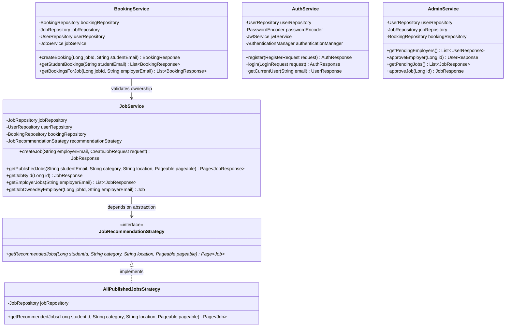
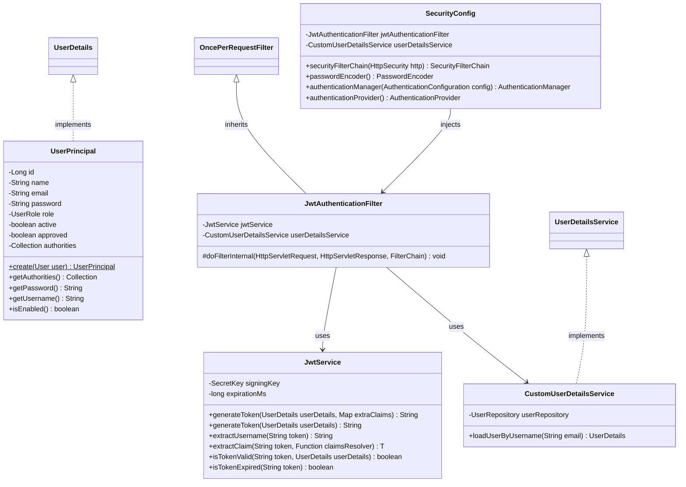
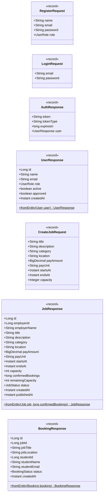

# UniShift / NextShift — System Class Diagram & OOP Design

මෙම ලේඛනය මඟින් UniShift (NextShift) backend පද්ධතියේ සම්පූර්ණ Object-Oriented Architecture එක සහ Class Diagram එක විස්තර කෙරේ.

---

## 1. Domain Model Class Diagram (Entities & Relationships)

පද්ධතියේ ප්‍රධාන Entity පන්ති අතර ඇති Inheritance (උරුමය), Associations (සම්බන්ධතා), සහ Enums පහත පරිදි වේ:

```mermaid
classDiagram
    direction TB

    class BaseEntity {
        <<abstract>>
        -Long id
        -Instant createdAt
        -Instant updatedAt
        #onCreate() void
        #onUpdate() void
        +getId() Long
        +setId(Long id) void
        +getCreatedAt() Instant
        +setCreatedAt(Instant createdAt) void
        +getUpdatedAt() Instant
        +setUpdatedAt(Instant updatedAt) void
        +equals(Object o) boolean
        +hashCode() int
    }

    class User {
        -String name
        -String email
        -String passwordHash
        -UserRole role
        -boolean active
        -boolean approved
        +approve() void
        +isStudent() boolean
        +isEmployer() boolean
        +isAdmin() boolean
        +canCreateJobs() boolean
        +getName() String
        +setName(String name) void
        +getEmail() String
        +setEmail(String email) void
        +getPasswordHash() String
        +setPasswordHash(String passwordHash) void
        +getRole() UserRole
        +setRole(UserRole role) void
        +isActive() boolean
        +setActive(boolean active) void
        +isApproved() boolean
        +setApproved(boolean approved) void
    }

    class UserRole {
        <<enumeration>>
        STUDENT
        EMPLOYER
        ADMIN
    }

    class Job {
        -User employer
        -String title
        -String description
        -String category
        -String location
        -BigDecimal payAmount
        -String payUnit
        -Instant startsAt
        -Instant endsAt
        -int capacity
        -JobStatus status
        -Instant publishedAt
        +publish() void
        +reject() void
        +close() void
        +isEligibleForBooking(Instant now) boolean
        +getEmployer() User
        +setEmployer(User employer) void
        +getTitle() String
        +setTitle(String title) void
        +getDescription() String
        +setDescription(String description) void
        +getCategory() String
        +setCategory(String category) void
        +getLocation() String
        +setLocation(String location) void
        +getPayAmount() BigDecimal
        +setPayAmount(BigDecimal payAmount) void
        +getPayUnit() String
        +setPayUnit(String payUnit) void
        +getStartsAt() Instant
        +setStartsAt(Instant startsAt) void
        +getEndsAt() Instant
        +setEndsAt(Instant endsAt) void
        +getCapacity() int
        +setCapacity(int capacity) void
        +getStatus() JobStatus
        +setStatus(JobStatus status) void
        +getPublishedAt() Instant
        +setPublishedAt(Instant publishedAt) void
    }

    class JobStatus {
        <<enumeration>>
        PENDING
        PUBLISHED
        REJECTED
        CLOSED
    }

    class Booking {
        -Job job
        -User student
        -BookingStatus status
        +getJob() Job
        +setJob(Job job) void
        +getStudent() User
        +setStudent(User student) void
        +getStatus() BookingStatus
        +setStatus(BookingStatus status) void
    }

    class BookingStatus {
        <<enumeration>>
        CONFIRMED
        CANCELLED
    }

    %% Inheritance
    BaseEntity <|-- User : inherits
    BaseEntity <|-- Job : inherits
    BaseEntity <|-- Booking : inherits

    %% Associations
    User "1" <-- "0..*" Job : employer
    User "1" <-- "0..*" Booking : student
    Job "1" <-- "0..*" Booking : job

    User ..> UserRole : uses
    Job ..> JobStatus : uses
    Booking ..> BookingStatus : uses
```

---

## 2. Recommendation Engine & Service Architecture (Strategy Pattern)

OOP Abstraction සහ Polymorphism මූලධර්ම භාවිතයෙන් Recommendation Engine එක Strategy Pattern එක අනුව නිර්මාණය කර ඇත:

---

## 3. Full System Architecture (Controllers, Services & Repositories)

පද්ධතියේ Controllers, Services, Repositories සහ Security Filters අතර සම්බන්ධතාවය:

```mermaid
classDiagram
    direction TB

    %% Controllers
    class AuthController {
        -AuthService authService
        +register(RegisterRequest request) ResponseEntity~AuthResponse~
        +login(LoginRequest request) ResponseEntity~AuthResponse~
        +getCurrentUser(UserDetails userDetails) ResponseEntity~UserResponse~
    }

    class JobController {
        -JobService jobService
        +getPublishedJobs(String category, String location, UserDetails userDetails, Pageable pageable) ResponseEntity~Page~JobResponse~~
        +getJobById(Long id) ResponseEntity~JobResponse~
        +createJob(UserDetails userDetails, CreateJobRequest request) ResponseEntity~JobResponse~
    }

    class BookingController {
        -BookingService bookingService
        +bookJob(Long id, UserDetails userDetails) ResponseEntity~BookingResponse~
        +getMyBookings(UserDetails userDetails) ResponseEntity~List~BookingResponse~~
    }

    class EmployerController {
        -JobService jobService
        -BookingService bookingService
        +getMyJobs(UserDetails userDetails) ResponseEntity~List~JobResponse~~
        +getJobBookings(Long id, UserDetails userDetails) ResponseEntity~List~BookingResponse~~
    }

    class AdminController {
        -AdminService adminService
        +getPendingEmployers() ResponseEntity~List~UserResponse~~
        +approveEmployer(Long id) ResponseEntity~UserResponse~
        +getPendingJobs() ResponseEntity~List~JobResponse~~
        +approveJob(Long id) ResponseEntity~JobResponse~
    }

    class HealthController {
        +health() ResponseEntity~Map~
    }

    %% Repositories
    class UserRepository {
        <<interface>>
        +findByEmail(String email) Optional~User~
        +existsByEmail(String email) boolean
        +findByRoleAndApprovedFalse(UserRole role) List~User~
    }

    class JobRepository {
        <<interface>>
        +findByIdWithLock(Long id) Optional~Job~
        +findByIdWithEmployer(Long id) Optional~Job~
        +findByEmployerIdOrderByCreatedAtDesc(Long employerId) List~Job~
        +findByStatusOrderByCreatedAtDesc(JobStatus status) List~Job~
        +findEligibleJobs(...) Page~Job~
    }

    class BookingRepository {
        <<interface>>
        +existsByJobIdAndStudentId(Long jobId, Long studentId) boolean
        +countByJobIdAndStatus(Long jobId, BookingStatus status) long
        +findByStudentIdOrderByCreatedAtDesc(Long studentId) List~Booking~
        +findByJobIdOrderByCreatedAtDesc(Long jobId) List~Booking~
        +findByJobIdAndStatusOrderByCreatedAtDesc(Long jobId, BookingStatus status) List~Booking~
    }

    %% Controller to Service
    AuthController --> AuthService
    JobController --> JobService
    BookingController --> BookingService
    EmployerController --> JobService
    EmployerController --> BookingService
    AdminController --> AdminService

    %% Service to Repository
    AuthService --> UserRepository
    JobService --> JobRepository
    JobService --> UserRepository
    JobService --> BookingRepository
    BookingService --> BookingRepository
    BookingService --> JobRepository
    BookingService --> UserRepository
    AdminService --> UserRepository
    AdminService --> JobRepository
    AdminService --> BookingRepository
```

---

## 4. Security & Authentication Architecture

---

## 5. DTO Records (Data Transfer Objects)

---

## 6. OOP මූලධර්ම ක්‍රියාත්මක කර ඇති ආකාරය පිළිබඳ සාරාංශය

1. **Encapsulation (කැප්සියුලීකරණය)**:
   - සියලුම entities හි fields `private` කර ඇත.
   - Entity හි තත්ත්ව වෙනස්වීම් (`publish()`, `approve()`, `isEligibleForBooking()`) entity එක තුළම ආරක්ෂිත domain methods මඟින් පාලනය වේ.

2. **Abstraction (වියුක්තකරණය)**:
   - `JobRecommendationStrategy` අතුරුමුහුණත (interface) මඟින් රැකියා නිර්දේශ කිරීමේ ඇල්ගොරිතමයේ ක්‍රියාකාරීත්වය application layer එකෙන් වෙන් කර ඇත.

3. **Polymorphism (බහුරූපතාවය)**:
   - `JobService` එක සෘජුවම concrete class එකක් මත රඳා නොපවතින අතර, `JobRecommendationStrategy` interface එක මත පමණක් රඳා පවතී. අනාගතයේදී වෙනත් recommendations ඇල්ගොරිතමයක් ලියූ විට `JobService` වෙනස් නොකර එය සම්බන්ධ කළ හැක.

4. **Inheritance (උරුමය)**:
   - `BaseEntity` mapped superclass එක මඟින් `id`, `createdAt`, `updatedAt` වැනි පොදු ගුණාංග සහ methods සියලුම entities (`User`, `Job`, `Booking`) වෙත සාධාරණීකරණය කර උරුම කර දී ඇත.
